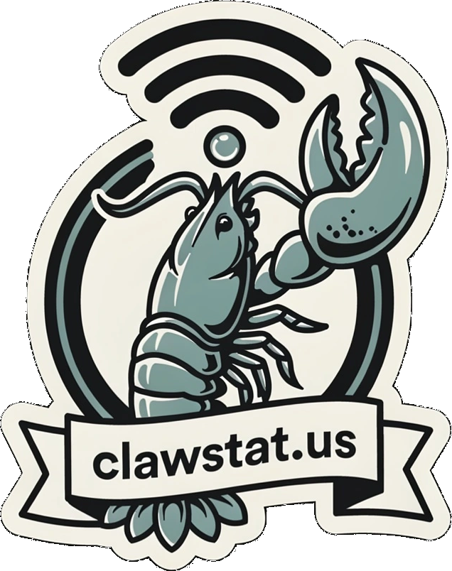
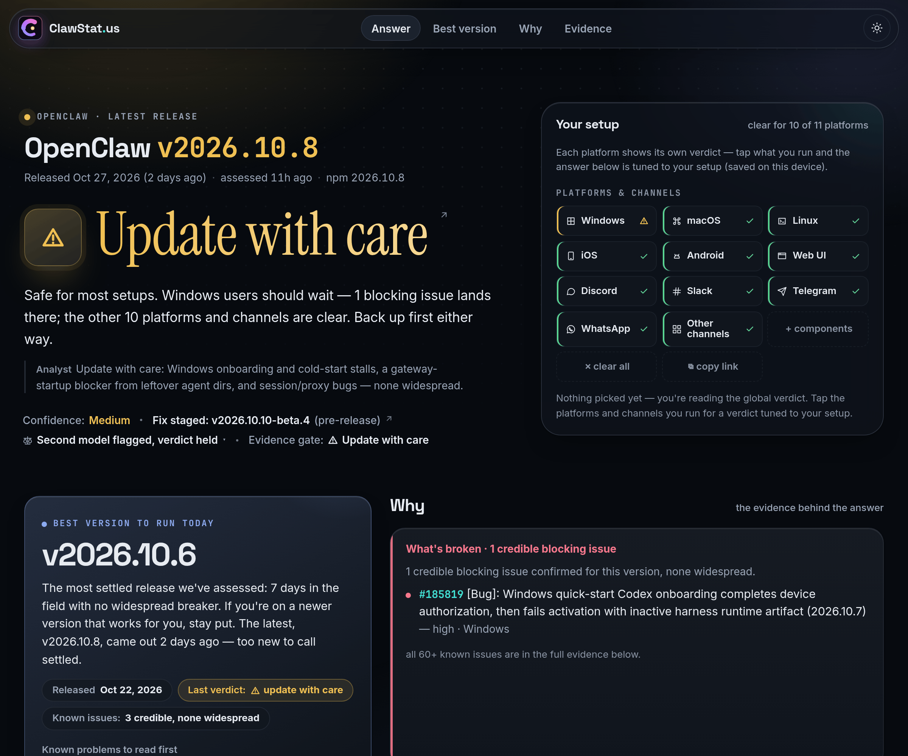

<p align="center">
  
</p>

# OpenClaw Status

**Should you update to the latest OpenClaw release?** This tool answers that, live at
**<https://clawstat.us>**.

<p align="center">
  
</p>

It watches the [`openclaw/openclaw`](https://github.com/openclaw/openclaw) repo, finds the bugs
people hit after each release, has two AI models from different providers weigh them, and
publishes one page with a verdict:

| Verdict | Meaning |
|---------|---------|
| ✅ Safe to update | No credible blocking issue for this release |
| ⚠️ Update with care | Some setups should wait; the page says which |
| ⏸️ Skip this version | The open issues outweigh the benefits |

A new release shows **Too new to call** for its first two days or first three checks, whichever
ends first (unless it is already a skip). The page also names the **best version to run today**:
the newest release that has been out for a week without widespread problems.

## How it works

Each run goes **collect → assess → render**:

1. **Collect**: releases and issues from GitHub, the latest version from npm. Issues are ranked
   by the repo's own severity labels and by whether they hit this exact version.
2. **Assess**: a rule in code sets the minimum caution from the credible blockers. One model
   writes the verdict and a second, from a different provider, reviews it. The verdict can be
   more cautious than the rule, never less.
3. **Render**: a static page with no external dependencies, plus `latest.json` (a public API),
   an RSS feed, the badge and `llms.txt` for agents. Low-confidence or broken results are never
   published.

A run takes a few minutes and costs about $0.02.

## Use the verdict in your update script

```bash
status=$(curl -fsS https://clawstat.us/latest.json | jq -r '.status.key')
if [ "$status" = "update" ]; then
  your-openclaw-update-command
else
  echo "clawstat.us says '$status' — holding this update"
fi
```

`.status.key` is `update`, `care`, `skip` or `wait`. Check it rather than `.recommendation`,
which shows a verdict even while a release is too new to call. If the site is down, `$status` is
empty and the script holds. To also allow ⚠️, add `|| [ "$status" = "care" ]`; don't test
`!= "skip"`, which would go ahead when the site is down.

To follow the settled release instead of the newest, read
`.recommended_version.version // empty`.

## Run it yourself

Needs Python 3.10+, an [OpenRouter](https://openrouter.ai) key and a read-only GitHub token
(details in [`.env.example`](.env.example)).

```bash
pip install -r requirements.txt
cp .env.example .env     # add OPENROUTER_API_KEY and GITHUB_TOKEN
python3 run.py full      # collect → assess → render to web/index.html
python3 -m pytest        # tests, no network needed
```

- **Alerts (optional):** set `ALERT_WEBHOOK_URL` in `.env` to send problems and verdict changes
  to Slack or Discord.
- **Hosting:** [`deploy/`](deploy/) sets up an Ubuntu box with Caddy (HTTPS) and an hourly
  systemd timer: `sudo deploy/provision.sh <your-domain>`. Run
  [`deploy/watchdog.py`](deploy/watchdog.py) from a second machine to get an alert if the site
  goes down.
- **Front end:** the page's client is in `web-src/` (Svelte). After editing it, run `npm ci` and
  `python3 tools/build.py`. Browser tests: [`tests/browser/README.md`](tests/browser/README.md).

## License

[MIT](LICENSE)
